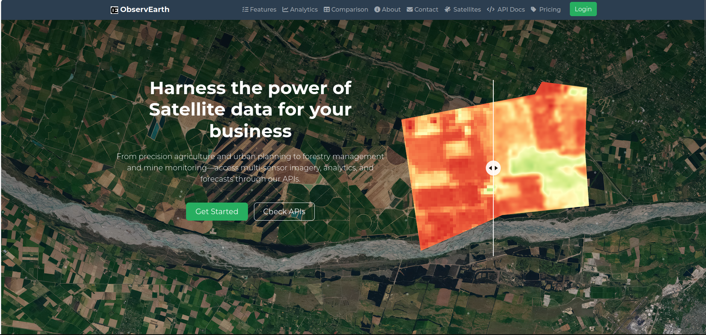
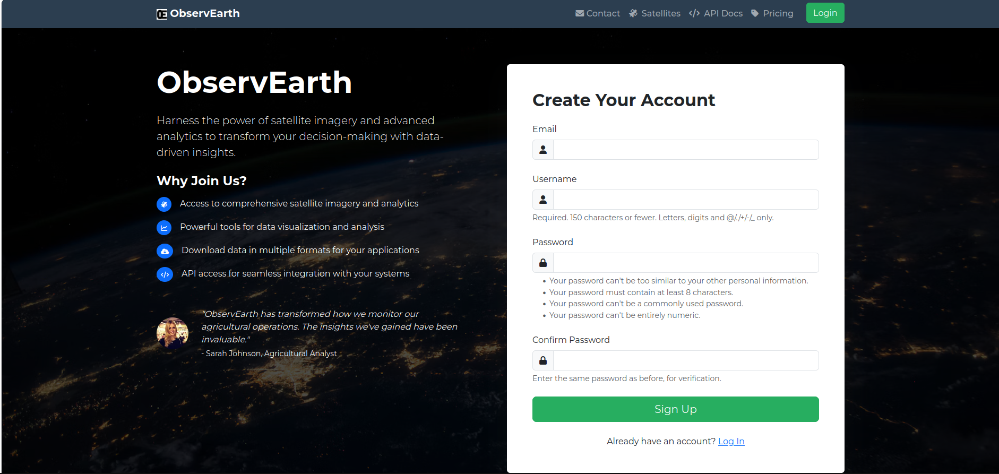
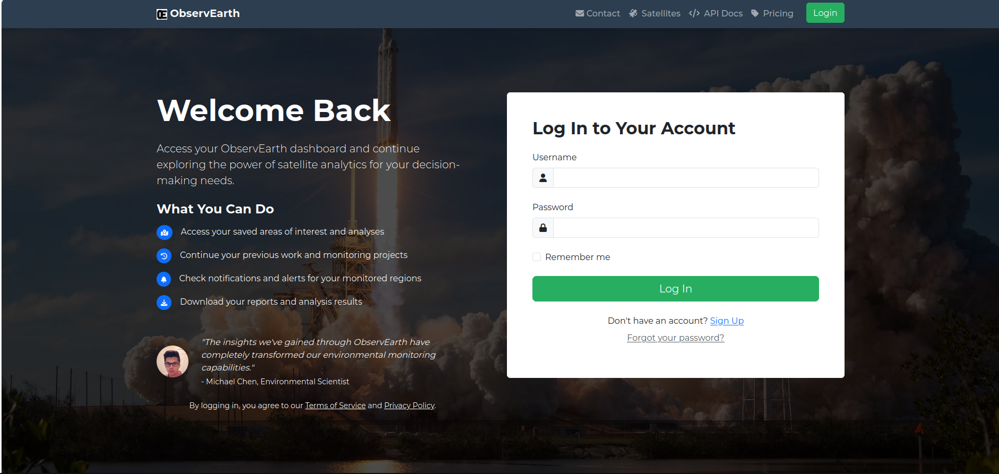
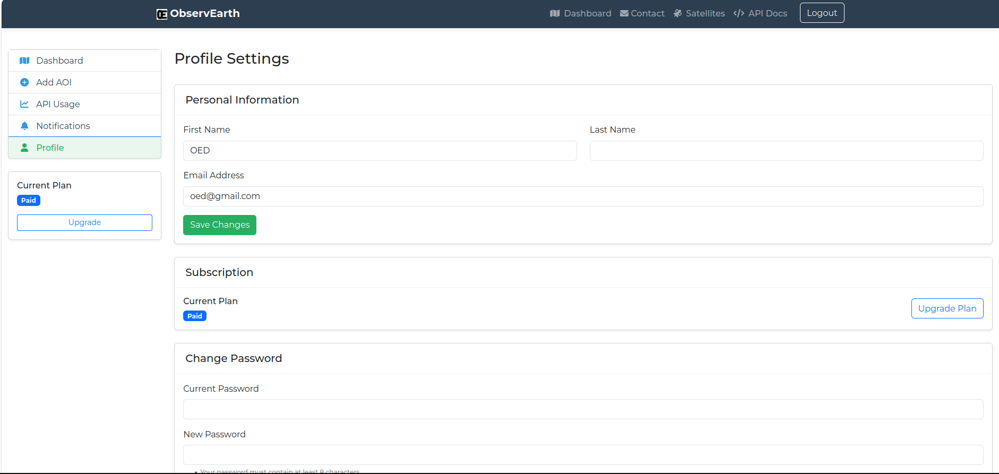

# Creating an Account

Getting started with ObservEarth takes less than two minutes. This guide walks you through registering an account, understanding initial quotas, logging in, and managing your profile.

---

## Registration Steps

### 1. Navigate to the Signup Page

Visit the ObservEarth registration portal at [https://observearth.com/signup/](https://observearth.com/signup/) (or `/signup/` on your local deployment).

### 2. Complete the Signup Form

Provide your account credentials:

* **Username**: A unique alphanumeric handle used for dashboard sign-in and identification.
* **Email Address**: Used for critical system notifications, billing updates, and alert triggers.
* **Password**: Must be at least 8 characters long and follow secure password guidelines.
* **Confirm Password**: Re-enter password for verification.

### 3. Immediate Activation

Upon clicking **Create Account**, your account is provisioned instantly:

* **User record created**: Your account credentials become active immediately.
* **API Key assigned**: A unique UUIDv4 API key is automatically generated.
* **Initial land quota**: You receive default access to **500 hectares** (5,000,000 m² / 5 sq km) of cumulative area coverage on the **Research & Non-commercial** plan.
* **Sensors unlocked**: Full access is granted to Sentinel-2, Sentinel-1, Landsat, MODIS, and weather services.
* **Workspace ready**: You are redirected to your active **Dashboard**.

---

## Logging In

If you already have an account:

1. Navigate to [https://observearth.com/login/](https://observearth.com/login/) (or `/login/`).
2. Input your registered **Username** and **Password**.
3. Click **Log In**.
4. You will land directly on `/dashboard/`.

---

## Profile & Password Management

You can update your personal information or rotate your web dashboard credentials at any time from `/dashboard/profile/`:

* **Personal details**: Update your first name, last name, and display name.
* **Email address**: Keep your email current to ensure timely delivery of satellite alert notifications.
* **Subscription tier**: View your current plan (`Paid` or `Research`) and upgrade your quota.
* **Password updates**: Supply your current password and set a new password to maintain account security.

---

## Next Steps

Now that your account is created, proceed to [API Keys & Authentication](api-keys-auth.md) to retrieve your key and make your first authenticated request.
