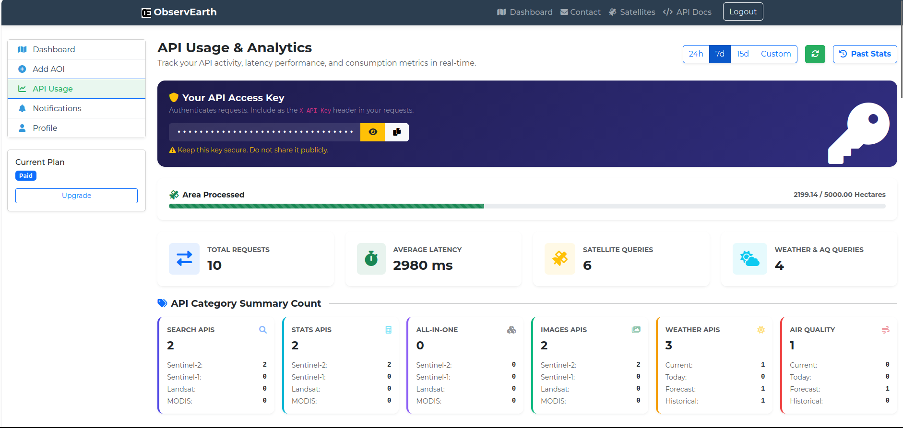

# API Keys & Authentication

Every API call made to the ObservEarth REST API requires programmatic authentication via a unique **API Key**.

---

## How to Get Your API Key

Your API key is generated automatically when your account is registered. To locate and copy your key:

1. Log into your ObservEarth account at [https://observearth.com/login/](https://observearth.com/login/).
2. In the left navigation menu, click **API Usage** (or visit `/dashboard/api-usage/`).
3. You will see your **API Key** presented in a secure card.
4. Click the **Reveal** eye icon to view the key, or click **Copy** to copy the string directly to your clipboard.



> [!WARNING]
> Your API key grants programmatic access to your registered areas, data processing jobs, and account allowances. Treat it like a secret password. Never commit your API key to public source code repositories (like GitHub or GitLab), client-side JavaScript applications, or mobile binaries.

---

## Passing the API Key in Requests

ObservEarth uses standard HTTP header-based authentication. Pass your API key in the `X-API-Key` HTTP header:

```http
X-API-Key: 123e4567-e89b-12d3-a456-426614174000
```

### Supported Header Names:

* `X-API-Key` (Recommended standard)
* `x-api-key` (Lowercase HTTP/2 standard)

---

## Verifying an API Key

You can test whether an API key is valid and active using the dedicated verification endpoint. This endpoint does not count against your billable rate limits.

### Endpoint
`POST /api/verify-api-key/`

### Request Headers
| Header | Type | Required | Description |
|---|---|---|---|
| `X-API-Key` | String (UUID) | No* | The API key to test (*or pass in request body) |
| `Content-Type` | String | Yes | `application/json` |

### Request Body
```json
{
  "api_key": "123e4567-e89b-12d3-a456-426614174000"
}
```

### cURL Request
```bash
curl -X POST "https://observearth.com/api/verify-api-key/" \
     -H "Content-Type: application/json" \
     -d '{"api_key": "123e4567-e89b-12d3-a456-426614174000"}'
```

### Response (200 OK)
```json
{
  "valid": true
}
```

If the key does not exist or has been disabled:
```json
{
  "valid": false
}
```

---

## Authentication Status Codes & Error Handling

When making API calls, ObservEarth returns standard HTTP response codes for authentication issues:

| Status Code | Reason | Cause | Solution |
|---|---|---|---|
| `401 Unauthorized` | Missing API Key | No `X-API-Key` header provided | Add `-H "X-API-Key: <key>"` to your request |
| `403 Forbidden` | Invalid API Key | The provided UUID is invalid, unrecognised, or deactivated | Verify key in `/dashboard/api-usage/` |
| `429 Too Many Requests` | Rate Limit Exceeded | Per-minute or monthly threshold crossed | Implement exponential backoff or upgrade plan |

### Standard 401 Error Response
```json
{
  "error": "Authentication credentials were not provided."
}
```

### Standard 403 Error Response
```json
{
  "error": "Invalid or inactive API key provided."
}
```

---

## Security Best Practices

### 1. Store API Keys in Environment Variables

Never hardcode your API key inside your source files. Use `.env` files and environment variable loaders:

* **Separation of secrets**: Keep sensitive tokens separate from version-controlled source code.
* **Easy rotation**: Update environment variables without needing code redeployment.

```python
import os
import requests

OBSERVEARTH_API_KEY = os.getenv("OBSERVEARTH_API_KEY")

headers = {
    "X-API-Key": OBSERVEARTH_API_KEY,
    "Content-Type": "application/json"
}
response = requests.get("https://observearth.com/api/geometry/", headers=headers)
```

### 2. Use a Backend Proxy for Web and Mobile Apps

If you are developing a customer-facing frontend (such as React, Vue, Flutter, iOS, or Android):

* **Route requests through your server**: Make API calls from your backend server, which attaches the secret API key.
* **Prevent key leakage**: Do not expose `X-API-Key` in browser network tabs or mobile app binaries.
