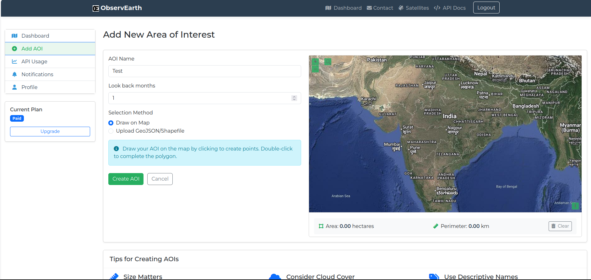

# Area of Interest (AOI) Management

In ObservEarth, an **Area of Interest (AOI)** or **Geometry** represents the physical boundary of an agricultural field, forest parcel, urban zone, or water reservoir. Every satellite calculation, weather extraction, and alert rule operates against a registered AOI.

---

## Defining an AOI

An AOI is defined as a GeoJSON `Polygon` or `MultiPolygon` in the standard **WGS84 (EPSG:4326)** coordinate reference system (longitude, latitude coordinates).

### GeoJSON Structure

```json
{
  "type": "Polygon",
  "coordinates": [
    [
      [77.5854, 12.9682],
      [77.5954, 12.9682],
      [77.5954, 12.9782],
      [77.5854, 12.9782],
      [77.5854, 12.9682]
    ]
  ]
}
```

> [!IMPORTANT]
> The coordinate array must form a closed linear ring: the first and last coordinate pair must be identical!

---

## Creating an AOI via Web Dashboard

To define a boundary using the visual interface:



1. Navigate to **Add AOI** (`/dashboard/add-aoi/`) in the dashboard menu.
2. Enter a descriptive **Farm Name** (e.g., `North Sector Corn Field`).
3. Use the interactive drawing toolbar on the top-right of the map to trace your field boundary:
   * Click each vertex around your parcel.
   * Double-click to close the polygon.
   * Alternatively, drag and drop a `.geojson`, `.kml`, or zipped `.shp` file.
4. The system calculates the area in real-time.
5. Click **Save AOI**.

---

## Automated Background Ingestion

When a new AOI is created (either through the dashboard or via `POST /api/geometry/`):

1. **Polygon Normalization**: The boundary is checked for self-intersections and normalized.
2. **UTM Projection & Area Computation**: The polygon is transformed to the local Universal Transverse Mercator (UTM) zone for millimeter-precise area calculation in hectares.
3. **Historical Data Ingestion**: A background Celery worker initiates historical satellite ingestion across the specified lookback window (default: 1 month, up to 12+ months).
4. **Automated Daily Monitoring**: The `daily_cron` flag (enabled by default) ensures the field is scanned automatically every morning for newly available satellite scenes.

---

## Managing Existing AOIs

From the dashboard table (`/dashboard/`):

* **View Details**: Opens the satellite explorer at `/dashboard/aoi/<geometry_id>/`.
* **Weather Station**: Opens the microclimate and soil moisture monitor at `/dashboard/aoi/<geometry_id>/weather/`.
* **Edit**: Rename the parcel or toggle `daily_cron` automated daily processing.
* **Delete**: Remove the geometry. Deleting immediately releases the parcel's hectarage back to your account's area quota.
