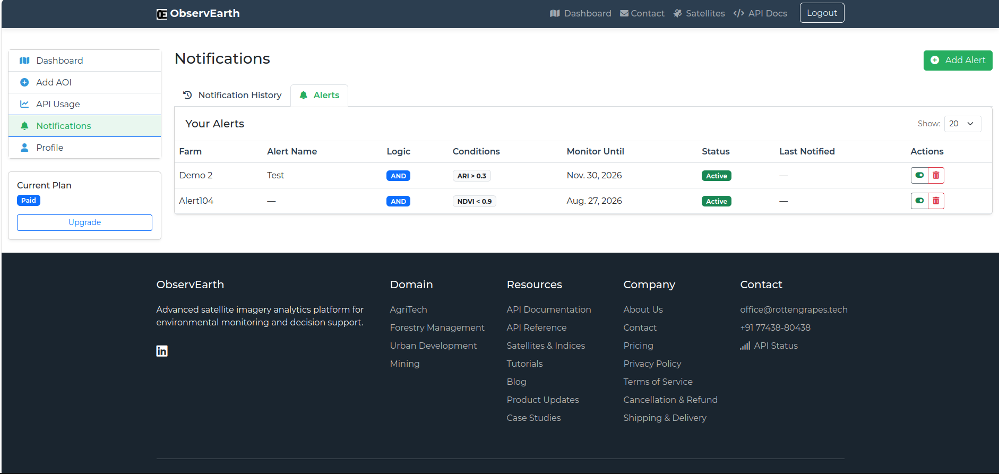

# Platform Walkthrough: Automated Alerts & Monitoring

Access **Notifications** (`/dashboard/alerts/` or `/notifications/`) to set up automated threshold alerts across your fields on [ObservEarth](https://observearth.com).

Whenever a newly ingested satellite pass occurs, ObservEarth automatically evaluates your conditions and sends out notifications.

---

## Active Alert Rules & Monitoring Dashboard

---

## 1. Alert Rule Management

* **Add Alert Button**: Click the green **+ Add Alert** button to configure a new monitoring rule for any of your registered AOIs.
* **Tabs Navigation**:
  * **Notification History**: Audit feed of all past triggered alerts with timestamps, recorded values, and farm associations.
  * **Alerts**: Current active monitoring rules configured for your account.

---

## 2. Rule Configuration & Fields

* **Farm**: Select the target monitored parcel (e.g., `Demo 2`, `Field 4`).
* **Alert Name**: Custom label assigned to the rule (e.g., `Vegetation Stress & Drought Watch`).
* **Logic**: Boolean combination logic (`AND` / `OR`).
* **Conditions**: Multi-condition expressions (e.g., `NDVI < 0.35`, `NDWI < -0.10`).
* **Monitor Until**: Rule expiration date (e.g., `Nov. 30, 2026`).
* **Status**: Active status badge (`Active` or `Paused`).
* **Actions**:
  * **Toggle Switch**: Instant enable or pause of active monitoring.
  * **Delete** (Red Trash Icon): Permanently delete rule.
