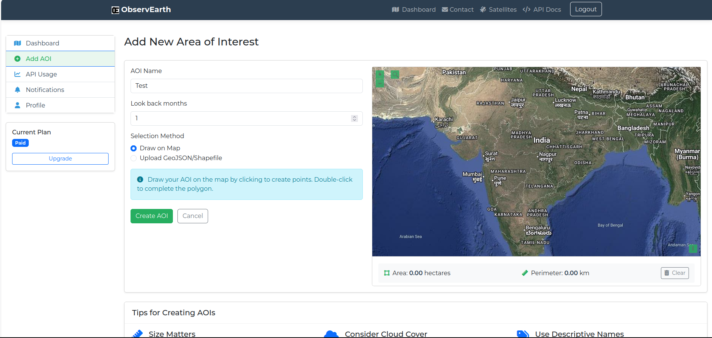

# Platform Walkthrough: AOI Creation & Drawing

Registering an **Area of Interest (AOI)** is the first step toward extracting satellite analytics, high-resolution imagery, and weather telemetry on [ObservEarth](https://observearth.com).

Navigate to **Add AOI** (`/dashboard/add-aoi/`) or click the green **+ Add New AOI** button from the dashboard.

---

## Interactive Geometry Drawing Interface

---

## Step-by-Step Boundary Registration

### Step 1: Configure AOI Properties

* **AOI Name**: Enter an identifiable name for your field or project (e.g., `Central Valley Field 4`).
* **Look Back Months**: Specify the historical satellite archive depth to scan upon registration (default: `1` month). ObservEarth automatically indexes all cloud-filtered scenes acquired within this period.
* **Selection Method**:
  * **Draw on Map**: Trace parcel boundaries manually on the interactive Leaflet map.
  * **Upload GeoJSON/Shapefile**: Upload `.geojson`, `.kml`, or zipped `.shp` files for instant boundary parsing.

### Step 2: Trace Boundary on Interactive Map

* Use the top search bar to locate your town, region, or latitude/longitude coordinates.
* Click anywhere on the map canvas to place perimeter vertex nodes.
* Double-click on the starting vertex or press enter to close the polygon ring.
* Drag existing vertex markers to fine-tune boundaries to fence lines or natural parcel borders.

### Step 3: Real-Time Footprint Telemetry

The telemetry bar at the bottom updates live as you place nodes:

* **Live Area Calculation**: Computes geodesic surface area dynamically in hectares (ha) and square meters (m²).
* **Perimeter Calculation**: Calculates perimeter distance in kilometers (km).
* **Clear**: Reset the current canvas and start a new boundary drawing.

### Step 4: Save & Background Ingestion

* Click the green **Create AOI** button.
* ObservEarth's backend Celery worker normalizes the polygon into WGS 84 (EPSG:4326), validates against your plan's maximum single AOI limit, checks available monthly hectare quota, and triggers historical scene cataloging across Sentinel-2, Sentinel-1, Landsat, and MODIS.
