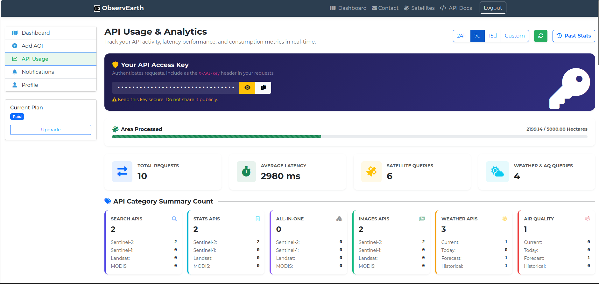
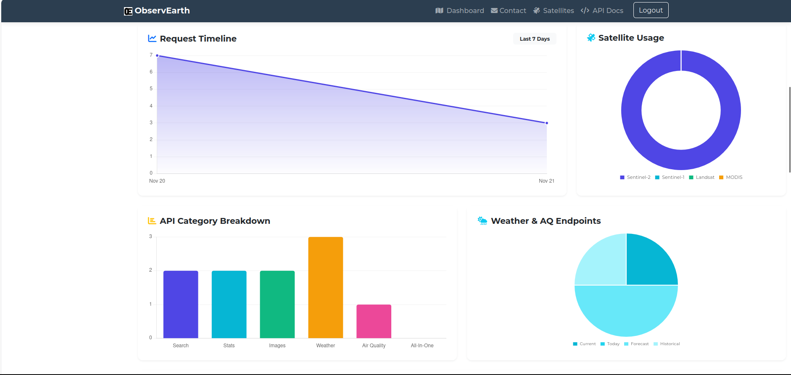
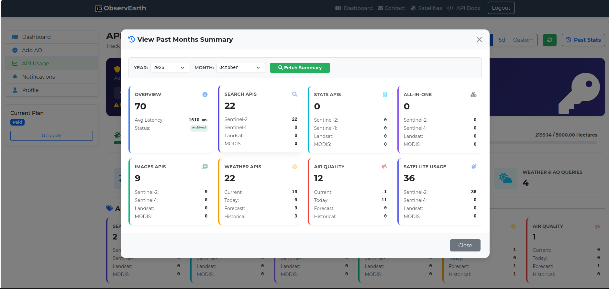

# Platform Walkthrough: API Usage & Key Analytics

Navigate to **API Usage** (`/dashboard/api-usage/`) to inspect your production credentials, track consumption against your quota, and analyze request performance on [ObservEarth](https://observearth.com).

---

## 1. Production API Key & Quota Meter

### Key Management & Quota Tracking

* **Your API Access Key**: Secure card displaying your masked secret key. Click the yellow eye icon to reveal the key, or click the copy icon to copy it to your clipboard.
* **Authentication Header**: Pass this key in the `X-API-Key` HTTP header for all programmatic API requests.
* **Area Processed Progress Bar**: Real-time progress bar displaying cumulative unique hectares processed (e.g., `2199.14 / 5000.00 Hectares`).
* **Time Range Filters**: Select telemetry intervals across `24h`, `7d`, `15d`, or `Custom`.
* **Real-Time KPIs**:
  * **Total Requests**: Cumulative calls executed (e.g., `10`).
  * **Average Latency**: Response execution speed (e.g., `2980 ms`).
  * **Satellite Queries**: Total queries directed to satellite pipelines (e.g., `6`).
  * **Weather & AQ Queries**: Total queries directed to weather and air quality endpoints (e.g., `4`).
* **API Category Summary Count**: Live counters broken down by Search, Stats, All-in-One, Images, Weather, and Air Quality APIs.

---

## 2. Request Volume Charts & Category Breakdowns

Scroll down on the API Usage page to inspect visual performance and endpoint distribution graphs.

### Performance Visualizations

* **Request Timeline (Last 7 Days)**: Line chart tracking daily API request volume trends.
* **Satellite Usage Donut Chart**: Breakdown of queries across Sentinel-2, Sentinel-1, Landsat, and MODIS constellations.
* **API Category Breakdown Bar Chart**: Visual comparison across Search, Stats, Images, Weather, and Air Quality endpoints.
* **Weather & AQ Endpoints Pie Chart**: Distribution of queries across Current, Today, Forecast, and Historical datasets.

---

## 3. Historical Usage Audits (Past Months Summary)

Click the **Past Stats** button in the top right of the API Usage dashboard to audit historical billing periods.

### Historical Audit Features

* **Year & Month Selector**: Select past calendar years and months (e.g., October 2026) and click **Fetch Summary**.
* **Archived Category Breakdown**: Displays historical call counts across Search APIs, Stats APIs, Images APIs, Weather APIs, Air Quality, and overall satellite sensor distribution.
* **Latency & Execution Records**: Review historical average execution latency for compliance and capacity planning.
