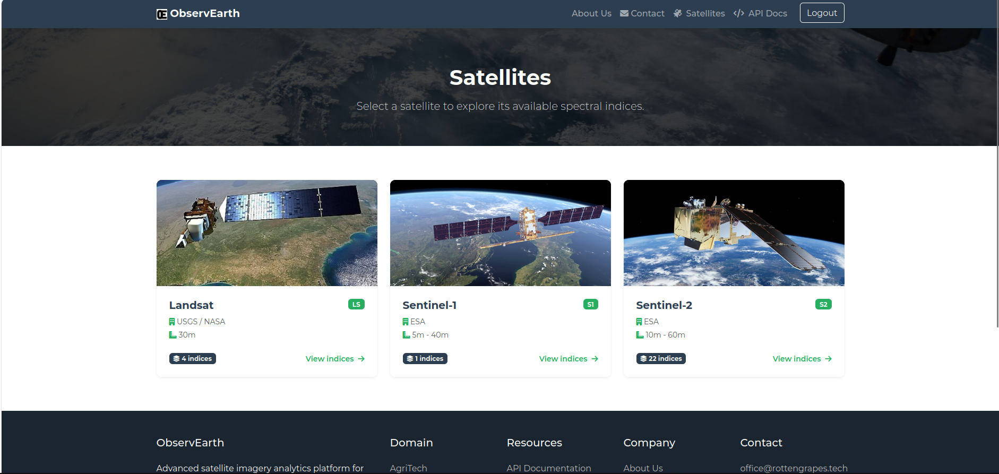
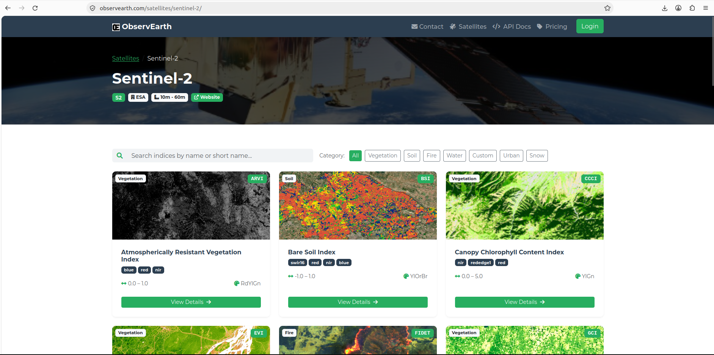
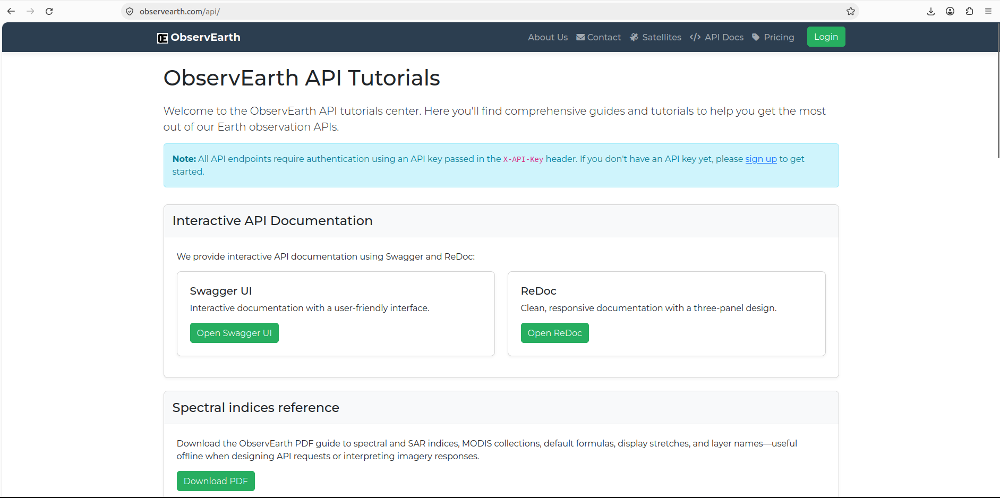

# Platform Walkthrough: Constellations & Index Directory

Explore the multi-sensor Earth Observation catalog, search over 45 supported spectral formulas, and access developer playgrounds on [ObservEarth](https://observearth.com).

---

## 1. Supported Satellite Constellations

Navigate to **Satellites** (`/satellites/`) from the top navigation bar to explore supported satellite constellations.

### Constellation Capabilities

* **Landsat 8 & 9**: USGS / NASA optical and thermal bands at 30m resolution with specialized vegetation and thermal indices.
* **Sentinel-1**: ESA C-band Synthetic Aperture Radar (SAR) with all-weather surface roughness and moisture penetrating capabilities (5m to 40m resolution).
* **Sentinel-2**: ESA multispectral imagery at 10m to 60m resolution supporting 22+ vegetation, water, soil, and fire indices.
* **MODIS**: Terra & Aqua daily 250m/500m composites for regional timeseries.

---

## 2. Sentinel-2 Spectral Indices Directory

Clicking **View indices** under Sentinel-2 opens the dedicated index catalog (`/satellites/sentinel-2/`).

### Index Catalog Features

* **Instant Search Bar**: Filter indices dynamically by keyword or acronym (e.g., `ARVI`, `BSI`, `CCCI`, `EVI`, `NDVI`).
* **Category Filters**: Filter by application: `All`, `Vegetation`, `Soil`, `Fire`, `Water`, `Custom`, `Urban`, `Snow`.
* **Interactive Index Cards**:
  * **ARVI** (Atmospherically Resistant Vegetation Index): Uses blue, red, and NIR bands with `RdYlGn` colormap (scale: 0.0 to 1.0).
  * **BSI** (Bare Soil Index): Uses SWIR16, red, NIR, and blue bands with `YlOrBr` colormap (scale: -1.0 to 1.0).
  * **CCCI** (Canopy Chlorophyll Content Index): Uses NIR, red edge, and red bands with `YlGn` colormap (scale: 0.0 to 5.0).
  * Click **View Details** on any card to view exact mathematical formulas, band wavelengths, and citation papers.

---

## 3. Interactive Developer API Hub (Swagger & ReDoc)

Navigate to **API Docs** (`/api/`) to access interactive API playgrounds and download offline reference materials.

### Developer Documentation Tools

* **Interactive Swagger UI**: Test REST API endpoints live in your browser with parameter validation and instant JSON response formatting.
* **ReDoc Interface**: Clean, responsive, 3-panel documentation view ideal for integration engineers.
* **Spectral Indices Reference PDF**: Download an offline manual of all spectral formulas, SAR polarizations, MODIS collections, and default colormap stretch boundaries.
