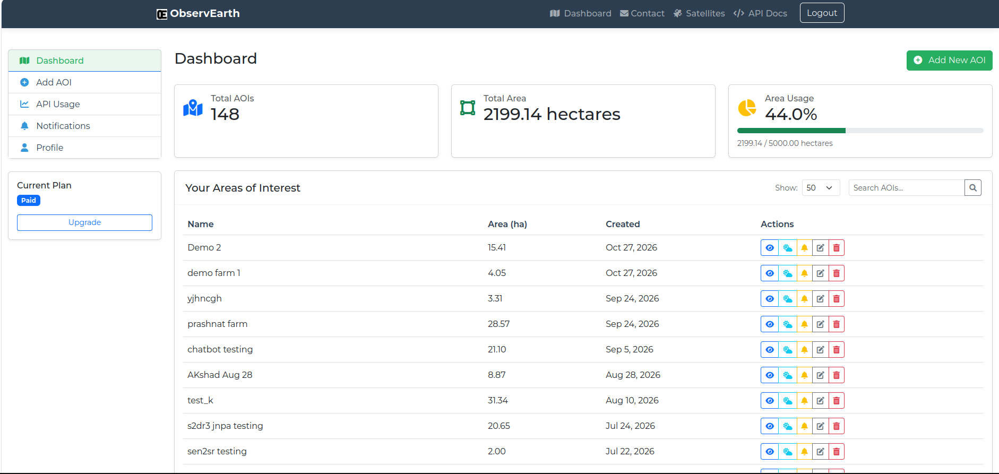

# Platform Walkthrough: Dashboard Overview

The **Main Dashboard** (`/dashboard/`) serves as your operational command center on [ObservEarth](https://observearth.com). It provides a real-time summary of your monitored land footprint, quota consumption, and saved farm boundaries.

---

## Dashboard Command Center

---

## 1. Top Telemetry Cards

* **Total AOIs**: Real-time counter of all registered parcels (e.g., `148` active fields).
* **Total Area**: Cumulative geographic land area monitored by ObservEarth (e.g., `2199.14 hectares`).
* **Area Usage Gauge**: Real-time capacity progress bar showing consumed hectares against your monthly subscription tier allowance (e.g., `44.0%` utilized of `5000.00 hectares`).

---

## 2. Monitored Areas of Interest (AOI) Inventory

The AOI table lists every parcel saved under your account:

* **Search AOIs**: Type any farm name or coordinate keyword into the search bar to filter records instantly.
* **Page Size Selector**: Switch between `10`, `20`, `50`, or `100` records per view.
* **Field Name & Calculated Area**: Displays each parcel's custom label and geodesic surface area in hectares (e.g., `15.41 ha`, `4.05 ha`, `28.57 ha`).

---

## 3. Quick Action Controls

Each row in the inventory table provides one-click operational shortcuts:

* **View Details** (Blue Eye Icon): Opens the [Satellite Explorer & Analytics](satellite-analytics.md) page (`/dashboard/aoi/<id>/`) to inspect spectral indices, cloud cover filters, and date ribbons.
* **Weather** (Blue Sun Icon): Opens the dedicated [Agrometeorological Weather Station](weather.md) (`/dashboard/aoi/<id>/weather/`) for live sensor telemetry and 7-day agronomic forecasts.
* **Notifications** (Yellow Bell Icon): Opens the field's [Automated Threshold Alerts](alerts.md) monitoring rules.
* **Edit** (Pencil Icon): Update the parcel boundary, name, or metadata.
* **Delete** (Red Trash Icon): Permanently deletes the field and immediately releases hectares back to your account quota.
