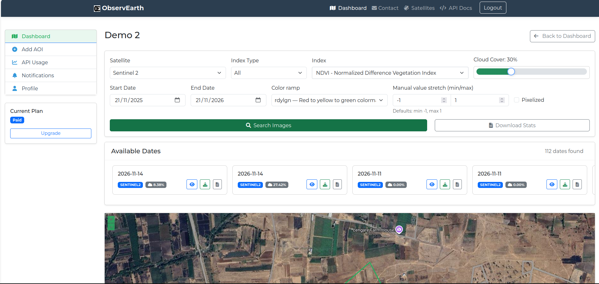
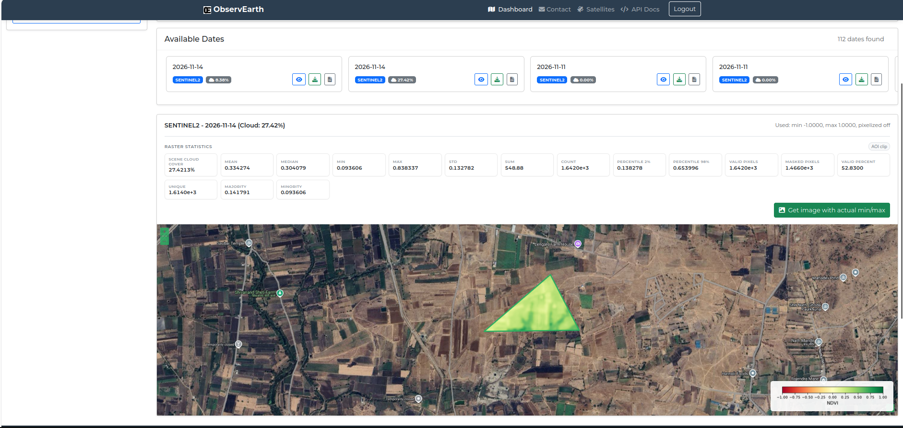

# Platform Walkthrough: Satellite Explorer & Analytics

Clicking **View Details** (blue eye icon) on any farm in the dashboard opens the **AOI Explorer** (`/dashboard/aoi/<id>/`). Here you can search multi-constellation imagery, select from 45+ spectral indices, render colormapped rasters, and inspect zonal statistics.

---

## 1. Multi-Sensor Filter Controls

### Control Toolbar Capabilities

* **Satellite Selector**: Switch between constellations:
  * **Sentinel 2**: 10m to 20m optical multispectral imagery with 5-day revisit cycles.
  * **Sentinel 1**: 10m C-band Synthetic Aperture Radar (SAR) for all-weather moisture and flood penetration.
  * **Landsat**: 30m optical and thermal infrared multispectral data.
  * **MODIS**: Daily global coverage across 250m and 500m land bands.
* **Index Category & Specific Formula**: Filter by application category (`All`, `Vegetation`, `Water`, `Soil`, `Urban`, `Fire`, `Stress`, `Snow`) and pick from over 45 formulas (e.g., `NDVI`, `EVI`, `NDRE`, `NDWI`, `BSI`).
* **Cloud Cover Tolerance**: Drag the slider (0% to 100%) to filter out cloud-obscured scenes (e.g., set to `<= 30%`).
* **Date Range Pickers**: Define your observation window with **Start Date** and **End Date**.
* **Colormap & Value Stretch**:
  * Choose your visualization palette (e.g., `rdylgn` — Red to Yellow to Green, `viridis`, `plasma`).
  * Set manual stretch bounds (e.g., min `-1`, max `1`).
  * Toggle **Pixelized** to inspect raw sensor pixels without bilinear smoothing.
* **Search Images** (Green button): Executes the catalog search.
* **Download Stats** (CSV button): Exports statistical timeseries across all available passes.

### Available Dates Carousel

Populates with all discovered acquisitions (e.g., `112 dates found`):

* Displays acquisition date (e.g., `2026-11-14`), satellite badge (`SENTINEL2`), and cloud cover percentage (e.g., `8.38%`, `27.42%`, `0.00%`).
* Action buttons allow one-click map projection, raster downloading, and statistics inspection.

---

## 2. Interactive Map Rasters & Zonal Statistics

Selecting an acquisition date renders the processed satellite raster clipped precisely to your parcel boundaries and computes detailed zonal statistics.

### Zonal Statistics Telemetry

* **Scene Cloud Cover**: Percentage of cloud cover detected across the parent scene tile (e.g., `27.42%`).
* **Mean & Median**: Field-wide average (e.g., `0.334274`) and median (e.g., `0.304079`) vegetative vigor.
* **Min & Max**: Lowest observed value (e.g., `0.093606`) and peak canopy value (e.g., `0.838337`).
* **Standard Deviation (Std)**: Spatial uniformity across the field (e.g., `0.132782`).
* **Sum**: Aggregate sum of all valid pixels within the boundary (e.g., `548.88`).
* **Percentiles (2% & 98%)**: Outlier boundary thresholds (e.g., P2% `0.138278`, P98% `0.653996`).
* **Valid & Masked Pixels**: Pixel breakdown (e.g., `1,642` valid pixels, `1,466` masked/exterior pixels, `52.83%` valid coverage).
* **Get Image with Actual Min/Max**: Re-renders the visualization stretched dynamically between the field's actual minimum and maximum observed values for maximum visual contrast.
