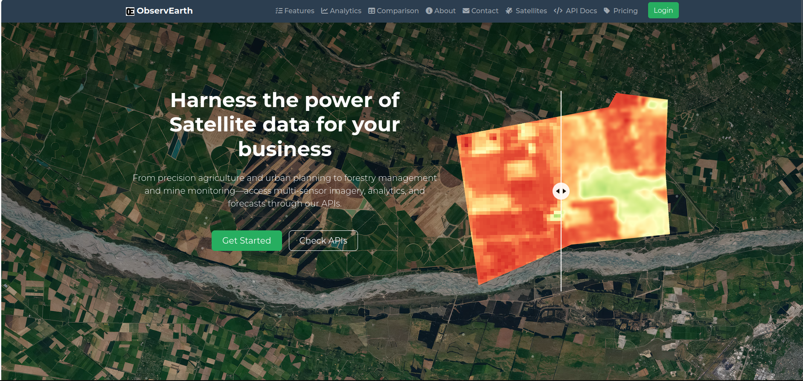
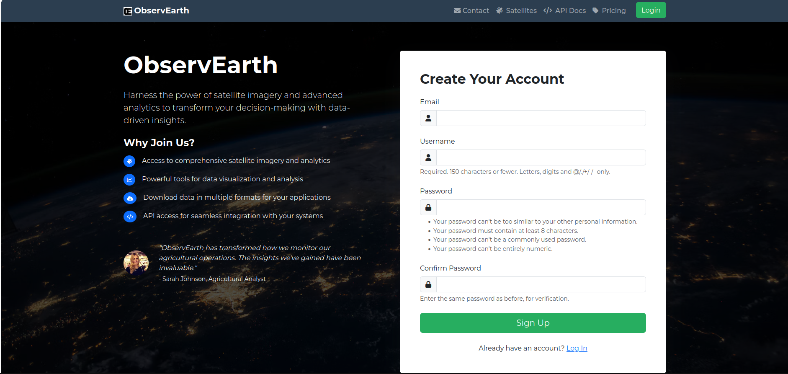
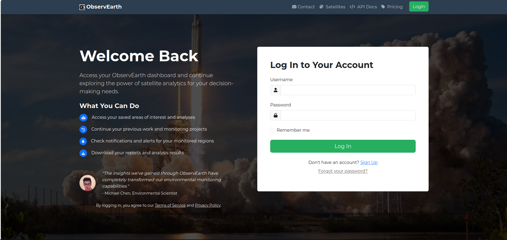
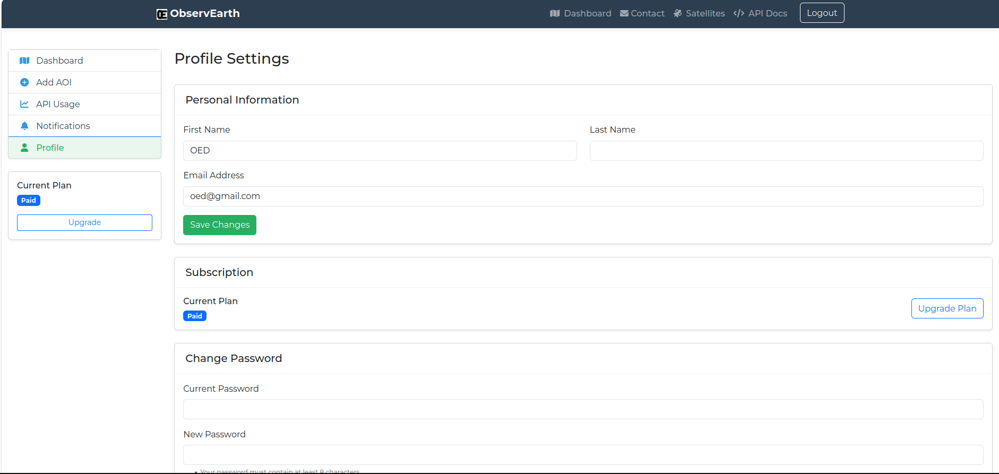

# Platform Walkthrough: Signup, Login & Profile

Welcome to the **ObservEarth** onboarding guide. This section covers account registration, user authentication, profile preferences, and subscription tier settings on [observearth.com](https://observearth.com).

---

## 1. Homepage & Landing Portal

The ObservEarth homepage provides an interactive introduction to the platform's multi-spectral remote sensing engine.

### Key Portal Capabilities

* **Interactive Split-Screen Slider**: Inspect before-and-after comparisons showing raw aerial imagery overlaid with false-color NDVI vegetation vigor heatmaps.
* **Industry Solutions**: Pre-configured workflows for precision agriculture, forestry carbon tracking, urban heat island mapping, and mining operations.
* **Top Navigation Bar**: One-click shortcuts to **Features**, **Analytics**, **Comparison**, **About**, **Contact**, **Satellites**, **API Docs**, and **Pricing**.
* **Quick Access**: Click **Get Started** to create an account or click **Login** to enter your workspace.

---

## 2. Creating an Account (Sign Up)

New users can register for an account in seconds at `/signup/`.

### Registration Form Fields

* **Email Address**: Used for billing confirmations, system alerts, and automated satellite notifications.
* **Username**: A unique alphanumeric handle (up to 150 characters; letters, digits, and `@/./+/-/_` permitted).
* **Password**: Must be at least 8 characters long, cannot be entirely numeric, cannot be a commonly used password, and cannot match personal details.
* **Confirm Password**: Re-enter the exact password to confirm.
* **Automatic Research Allocation**: Every new account automatically receives an initial allowance of **500 hectares** (5 km²) on the **Research & Non-commercial** plan.
* **Submit**: Click the green **Sign Up** button to immediately activate your account and generate your private API key.

---

## 3. Account Authentication (Log In)

Existing users can access their workspace at `/login/`.

### Login Flow

* **Username & Password**: Input your registered account credentials.
* **Remember Me**: Check this box to keep your browser session active.
* **Log In**: Click the green **Log In** button. Upon authentication, you are routed directly to your active **Dashboard** (`/dashboard/`).
* **Self-Service Links**: Access the **Sign Up** link if you need a new account or **Forgot your password?** for automated credential recovery.

---

## 4. Profile & Account Settings

Manage your personal details, credentials, and subscription status at `/dashboard/profile/`.

### Profile Management Sections

* **Personal Information**:
  * **First Name & Last Name**: Manage your account display identity.
  * **Email Address**: Update your registered email address.
  * Click **Save Changes** to persist your profile updates.
* **Subscription Status**:
  * Displays your active plan tier (e.g. `Paid` or `Research`).
  * Click **Upgrade Plan** to increase your cumulative monitored area allowance or unlock higher API request rate limits.
* **Change Password**:
  * Enter your **Current Password** and specify a **New Password** (minimum 8 characters) to maintain security.
