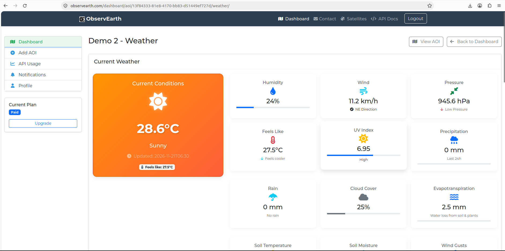
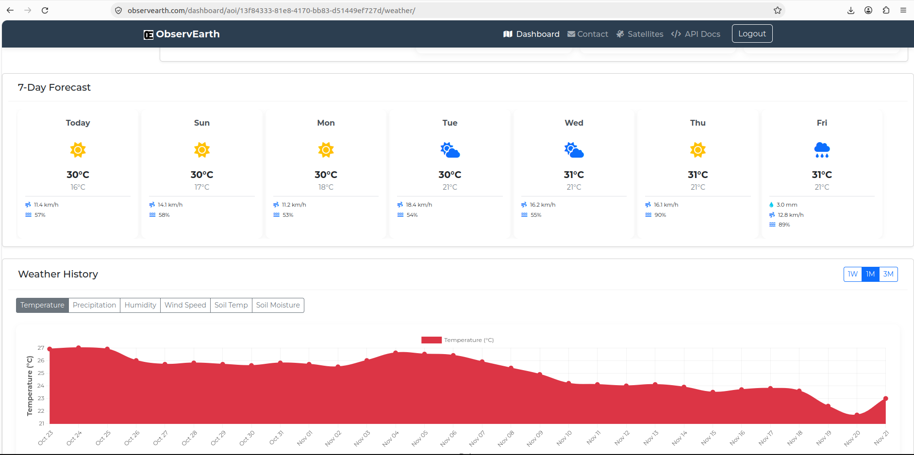

# Platform Walkthrough: Weather Station & Telemetry

Clicking the **Weather** (blue sun icon) from the dashboard or navigating to `/dashboard/aoi/<id>/weather/` opens the live agrometeorological and soil telemetry station on [ObservEarth](https://observearth.com).

---

## 1. Current Atmospheric & Agronomic Telemetry

### Real-Time Weather Readings

* **Current Conditions Hero Card**: Real-time ambient temperature (e.g., **28.6°C**), sky condition (**Sunny**), timestamp, and "Feels like" index (**27.5°C**).
* **Relative Humidity**: Real-time atmospheric moisture content (e.g., **24%** with visual status bar).
* **Wind Velocity & Direction**: Real-time wind speed and compass orientation (e.g., **11.2 km/h NE Direction**), vital for spray drift avoidance.
* **Surface Pressure**: Atmospheric barometric pressure reading (e.g., **945.6 hPa**).
* **UV Index**: Solar ultraviolet radiation intensity (e.g., **6.95 High**).
* **Precipitation & Rain**: Cumulative rainfall recorded over the past 24 hours (e.g., **0 mm**).
* **Cloud Cover**: Sky obscuration percentage (e.g., **25%**).
* **Reference Evapotranspiration (ET0)**: Calculated crop water loss via the FAO-56 Penman-Monteith equation (e.g., **2.5 mm**), providing data for irrigation scheduling.

---

## 2. 7-Day Forecast & Historical Climate Trends

Scroll down on the Weather Station page to review daily agronomic projections and multi-week climate progressions.

### Short-Term & Historical Forecast Tools

* **7-Day Agronomic Forecast**:
  * Daily forecast cards (Today through Friday) displaying weather icons, daily high and low temperatures (e.g., 30°C / 16°C), expected wind speed, and humidity.
  * Precipitation indicators highlight upcoming rain events (e.g., **3.0 mm** rain on Friday).
* **Weather History Timeframe**: Switch views across **1 Week (1W)**, **1 Month (1M)**, or **3 Months (3M)**.
* **Parameter Tabs**: Switch historical trend curves between:
  * **Temperature** (°C)
  * **Precipitation** (mm)
  * **Humidity** (%)
  * **Wind Speed** (km/h)
  * **Soil Temperature** (°C)
  * **Soil Moisture** (m³/m³)
* **Interactive Area Chart**: Illustrates diurnal fluctuations, temperature spikes, and moisture progressions over the selected period.
